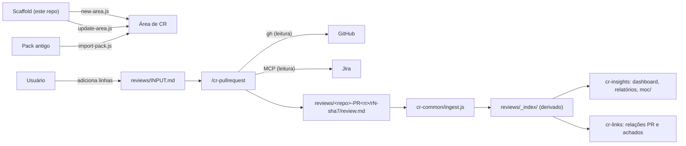

# crharness scaffold: visão geral

Contexto e mapa de leitura. Para o passo a passo, use [USAGE.md](USAGE.md), [../GUIDE.md](../GUIDE.md) e [../AJUDA.md](../AJUDA.md); este arquivo não os repete.

## Contexto

| Item | Descrição |
|---|---|
| Problema | Revisar PRs de backends Java + Spring (brownfield) contra a user story do Jira, sempre na mesma estrutura, sem perder o histórico entre rodadas |
| Solução | Este repositório é o **scaffold**: gera "áreas" de code review (`crharness`) permanentes, com skills do Claude Code que fazem a revisão |
| Escopo da revisão | Só as linhas que o PR alterou. Problemas em código não tocado vão para "Observações fora do escopo" e nunca bloqueiam |
| Postura | Somente leitura para GitHub e Jira: a skill nunca comenta, aprova, faz push nem escreve no Jira. Quem publica é o usuário |
| Dados sensíveis | A área guarda trechos de código e achados de segurança: é local, nunca versionada nem enviada a remoto. `.gitignore` bloqueia `reviews/*` neste repo |
| Stack | Node.js (sem dependências npm), Claude Code, `gh`, MCP Atlassian; Obsidian opcional |

Este repo não tem código de aplicação (sem controllers, endpoints nem testes automatizados): são scripts Node de manutenção e skills em Markdown/JS.

## Arquitetura

## Componentes

### Scripts do scaffold (`scripts/`, 3 arquivos, não vão para as áreas)

| Script | Função | Garantia |
|---|---|---|
| `new-area.js <pasta>` | Cria uma área nova copiando `CLAUDE.md`, `README.md`, `GUIDE.md`, `AJUDA.md`, `.claude/`, `.obsidian/` e criando `reviews/` | Recusa destino dentro do scaffold ou pasta não vazia |
| `update-area.js <área> [flags]` | Leva mudanças do scaffold para uma área existente | Nunca apaga (exceto `--prune-stale`, só pastas de skill) e não toca em `reviews/`; `graph.json` e `bookmarks.json` são do usuário e só são copiados se não existirem |
| `import-pack.js <pack> <área> [--dry-run]` | Importa revisões de um pack antigo | Idempotente: copia o que falta, pula idênticos, lista conflitos sem sobrescrever; não importa `STATUS.md` |

### Skills (`.claude/skills/`, 4 pastas)

| Skill | Papel | Conteúdo |
|---|---|---|
| `cr-pullrequest` | Revisa PRs contra o Jira; ponto de entrada único | 7 modos em `modes/`: init, review, revise, index, batch, sync, archive; `reviewer-prompt.md`; 4 templates |
| `cr-common` | Compartilhada | `scripts/ingest.js`: lê as revisões e gera `reviews/_index/items.json` e o ledger |
| `cr-insights` | Análise derivada | 7 scripts (`classify`, `facts`, `insights`, `oos-report`, `pendencias`, `build-dashboard`, `moc`), `taxonomy.json`, templates HTML |
| `cr-links` | Relações entre PRs e achados | `scripts/relations.js` (`scan`, `list`) |

### Estado de um PR (derivado, nunca digitado)

`novo`, `aguardando-anexos`, `revisado`, `publicado`, `desatualizado`, `encerrado`. `publicado` é declaração do usuário ("publiquei"); `encerrado` é verificado no GitHub. Detalhe em [crharness-design.md](crharness-design.md), seção 3.

## Guia de uso mínimo

1. Pré-requisitos: Node.js ≥ 16.7, `gh auth status` ok, MCP Atlassian, Claude Code.
2. Criar a área (uma vez): `node scripts/new-area.js ../minha-area`.
3. Abrir o Claude Code na área e adicionar uma linha por PR em `reviews/INPUT.md` (colunas `PR | Jira | Nota`).
4. Rodar `/cr-pullrequest` sem argumentos: a skill deriva o estado, mostra o plano e pergunta uma vez. Para um PR só: `/cr-pullrequest <URL do PR> <chave ou URL do Jira>`.
5. Ler `reviews/<repo>-PR<n>/rN-<sha7>/review.md` (em pt-BR) e publicar manualmente.
6. Autor deu push (SHA novo): repetir o comando, gera a rodada `r<N+1>`. Mesma versão com decisões do solicitante: dizer ao Claude, a rodada é editada no lugar.
7. Indicadores: pedir a skill `cr-insights` (modo `all`) para atualizar índice, dashboard e mapas Obsidian.
8. Levar melhorias do scaffold às áreas: `node scripts/update-area.js <área> --dry-run`, conferir, rodar sem `--dry-run`.

## Mapa de leitura

| Quero | Leia |
|---|---|
| Entender o repositório e os fluxos | [USAGE.md](USAGE.md) |
| Como a área funciona | [../GUIDE.md](../GUIDE.md) |
| O que rodar e quando, problemas comuns | [../AJUDA.md](../AJUDA.md) |
| Decisões de design da área | [crharness-design.md](crharness-design.md) |
| Especificação de links, taxonomia e dashboard | [crharness-links-insights-spec.md](crharness-links-insights-spec.md) |

## Limitações conhecidas

- `sync` chama `gh` uma vez por PR ativo: latência cresce com a fila.
- `publicado` não é verificável; depende do usuário.
- Não há testes automatizados neste repo; a validação é a "Verificação rápida" do [USAGE.md](USAGE.md).
- Os relatórios HTML de `cr-insights` trazem o texto das revisões: conferir `redact` em `reviews/_index/config.json` antes de compartilhar.

<!-- generated: 2026-10-20 | commit: 43c697d | stack: scaffold Node.js + skills Claude Code (sem stack suportada pela skill) -->
